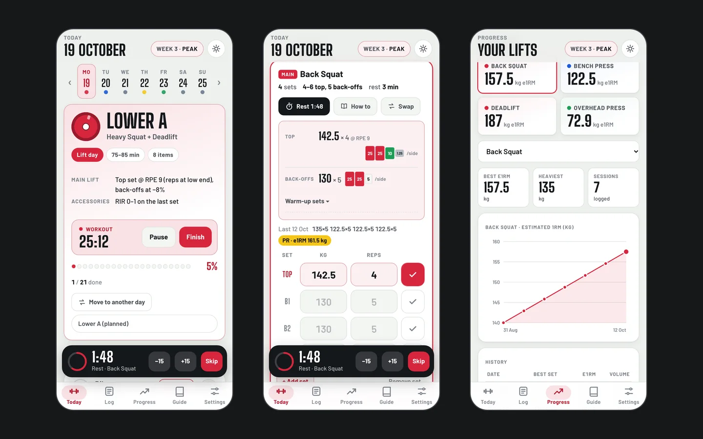

# Gym Log

A training PWA that suggests weights from previous sessions, times rests, and keeps workout data on the device.

[Portfolio case study](https://vadim-kravets.vercel.app/work/gym-log/) · [Vadim Kravets](https://vadim-kravets.vercel.app/)



## My role

Product direction, problem framing, scope, design decisions, and review. AI coding agents wrote implementation code and tests under my direction. This is an independent portfolio project.

## What to explore

- Workout logging and progression targets
- Exercise guidance, rest timers, and training reports
- Offline use and local JSON backup

## Try it locally

```sh
python3 -m http.server 8101 --bind 127.0.0.1
```

Open http://127.0.0.1:8101. This copy starts with its own browser data; no personal training records are included.

## About this public copy

This is a curated showcase snapshot with fresh Git history. It contains no production credentials, private project-session records, owner databases, or connection to the private working repository. Changes to this copy do not deploy or modify the working app. It has no inherited deployment integration, repository secrets, or paid Actions workflow.

The code can be reviewed and run locally. Forks and proposed changes do not grant write access to the original app. Public source is not a guarantee that software has no bugs.

[Usage and architecture reference](GUIDE.md) · [Publication checks](PUBLICATION.md)

## License and third-party material

Source is shared for portfolio review; no additional open-source license is granted for my original code. Bundled libraries, fonts, and documentation retain their respective licenses and notices.
